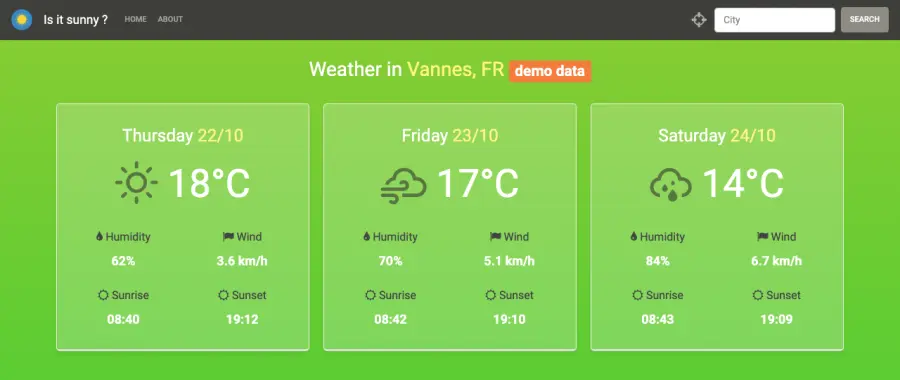
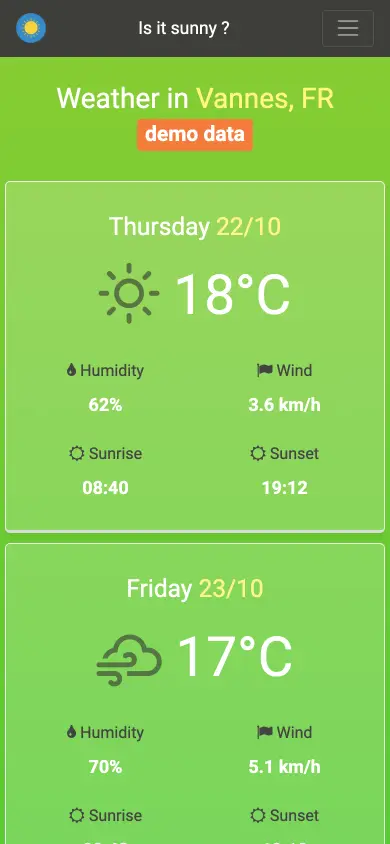

<p align="center"></p>

# Is it Sunny?

A lightweight weather page: current conditions and the next days' forecast for any city, or for where you are.

[](https://github.com/LaCobble/It_is_Sunny/actions/workflows/ci.yml)


[](LICENSE)

## What it does

A static web page (HTML, Bootstrap, jQuery) that calls the [OpenWeatherMap](https://openweathermap.org/api) forecast API and shows:

- temperature, humidity, wind speed, sunrise and sunset for today and the next two days;
- a search bar to look up any city (the default is Vannes, France);
- a geolocation button that loads the weather where you are;
- a **demo mode**: when no API key is configured, the page shows a sample three-day forecast for Vannes (from `assets/js/demo-data.js`) instead of calling the API.

## Screenshots

<table>
  <tr>
    <td width="70%"><br><sub>Three-day forecast on desktop</sub></td>
    <td width="30%"><br><sub>Phone width (390 px)</sub></td>
  </tr>
</table>

<sub>Captured with headless Chrome from a local run in demo mode (October 2026): without an API key the page shows sample data, flagged by the "demo data" badge.</sub>

## Prerequisites

- A modern web browser
- Optional: a free [OpenWeatherMap API key](https://home.openweathermap.org/users/sign_up) for live data (without it, the page runs in demo mode)

## Getting started

```bash
git clone https://github.com/LaCobble/It_is_Sunny.git
cd It_is_Sunny
```

1. Open `index.html` to try it right away in demo mode.
2. For live data, open `assets/js/app.js` and replace `YOUR_OPENWEATHERMAP_API_KEY` with your key. **Do not commit your key.** Then open `index.html` in your browser (or serve the folder, e.g. `python3 -m http.server`, which geolocation may require).

There is no build step and no test suite; the CI checks the JavaScript syntax, that every local asset referenced by the HTML exists, and scans for secrets.

## Project structure

```
It_is_Sunny/
├── index.html
└── assets/
    ├── css/        # Bootstrap and custom styles
    ├── img/        # icon, humidity icon, loader
    └── js/
        ├── app.js      # API calls and rendering
        ├── demo-data.js # sample forecast used in demo mode
        └── utility.js  # helpers (Kelvin to Celsius, padding, colour conversion)
```

## What it demonstrates

- Consuming a third-party REST API from the browser with AJAX.
- Browser geolocation and dynamic DOM updates with jQuery.
- Date/time handling with Moment.js and sun times with SunCalc.
- Responsive layout with Bootstrap.

## Context

Personal / school web project built in June 2023. Kept as a portfolio piece; no longer actively developed.

## Contributing

See [CONTRIBUTING.md](CONTRIBUTING.md) and the [Code of Conduct](CODE_OF_CONDUCT.md). Security issues: [SECURITY.md](SECURITY.md).

## License and credits

[MIT](LICENSE) © LaCobble. Weather data from [OpenWeatherMap](https://openweathermap.org/). Built with [Bootstrap](https://getbootstrap.com/), [jQuery](https://jquery.com/), [Moment.js](https://momentjs.com/), [SunCalc](https://github.com/mourner/suncalc), [Weather Icons](https://erikflowers.github.io/weather-icons/), [Balloon.css](https://kazzkiq.github.io/balloon.css/) and [Font Awesome](https://fontawesome.com/).
